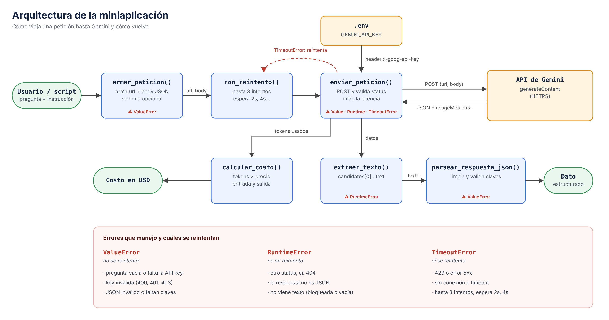

# Decisión de arquitectura: elección de modelo

Fecha: 25 de octubre de 2026

## Modelo elegido

**gemini-3.5-flash-lite**, consumido por la API REST de Gemini (`generateContent`).

## Diagrama de arquitectura

Es el mismo diagrama del Bloque 8 (también en [SVG](arquitectura.svg)). El modelo se define en una sola constante, `MODELO` en `src/consumir_gemini.py`. Entra al flujo en `armar_peticion()`, que lo pone en la url, y `calcular_costo()` usa los precios de ese mismo modelo. Por eso cambiar de modelo es tocar una línea y la tabla `PRECIOS`.

## Comparación de candidatos

Corrí `src/evaluacion_modelos.py` el 25 de octubre de 2026, en el free tier. Mismo prompt para los dos, 4 peticiones por modelo. Los números crudos están en [comparacion_modelos.md](comparacion_modelos.md).

- Pregunta: *¿Cada cuántos kilómetros debo cambiar el aceite de un motor a gasolina y qué riesgo hay si me atraso?*
- Instrucción de sistema: *Eres un asesor automotriz experto. Responde en máximo 2 frases.*

| | gemini-3.5-flash-lite | gemini-3.6-flash |
|---|---|---|
| Peticiones exitosas | 4/4 | 4/4 |
| Latencia promedio | 1.36 s | 12.83 s |
| Tokens de salida (promedio, incluye razonamiento) | 68 | 653 |
| Costo por petición | $0.000182 | $0.002478 |
| Costo de las 4 peticiones | $0.000727 | $0.009912 |
| Precio por millón de tokens (entrada / salida) | $0.30 / $2.50 | $0.75 / $3.75 (sube a $1.50 / $7.50 el 1 de enero de 2027) |
| Calidad en mi caso | Correcta: 5,000 a 10,000 km, riesgo de pérdida de lubricación y desgaste | Correcta, con más matices: menciona aceite mineral o sintético y el cambio al año |

El 3.6 tardó unas 9.4 veces más y costó unas 13.6 veces más por petición.

También probé `gemini-2.5-flash`, pero no respondió ninguna de las 4 peticiones (0/4), así que no entró en la comparación.

## Justificación

El criterio que más pesó fue la latencia, y después el costo. Mi miniaplicación es un asistente de taller: responde preguntas cortas y clasifica fallas en JSON. El usuario espera la respuesta en pantalla, y lo que necesita saber cabe en dos frases.

En calidad las dos respuestas dicen lo mismo en lo esencial. El 3.6 agrega detalle (tipo de aceite, el límite de un año), pero eso no cambia lo que el usuario va a hacer con la respuesta.

Los tokens de salida del 3.6 son casi 10 veces más (653 contra 68) aunque la respuesta visible mide lo mismo. Casi todo parece razonamiento interno, que se cobra como salida y explica la latencia. Para mi caso sería pagar y esperar por pensar algo que no necesito.

Lo que no medí: usé una sola pregunta y 4 repeticiones, y no probé los dos modelos con los prompts JSON de `consistencia.py`. Falta confirmar que flash-lite también devuelve JSON válido de forma estable.

## Alternativa descartada y por qué

Descarté **gemini-3.6-flash**. Responde con un poco más de detalle, pero 12.83 s por respuesta es demasiado para un asistente que el usuario espera, y cuesta unas 13.6 veces más por petición. Además su precio se duplica en enero de 2027, así que la diferencia crece.

Lo reconsideraría si la app pasa a diagnósticos más complejos que necesiten razonar más, o si flash-lite no mantiene el formato JSON en `consistencia.py`.
